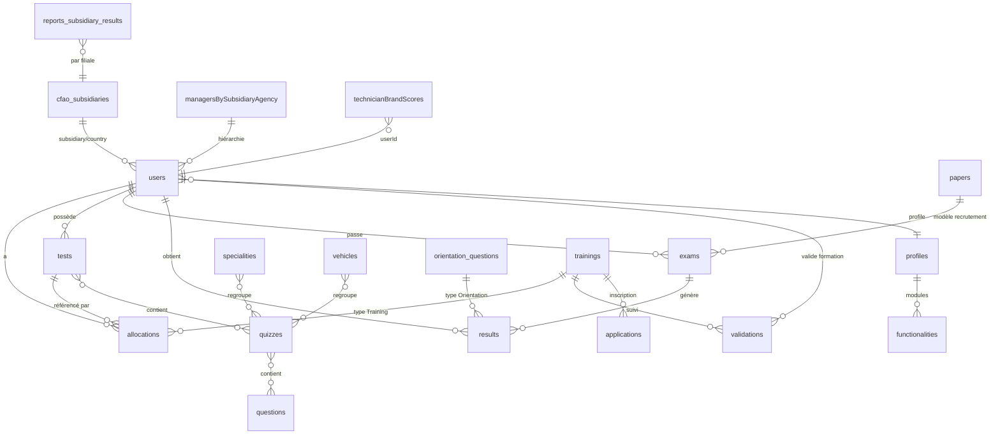

# Cartographie MongoDB — MEDACAP

> **Serveur :** `10.68.0.7:27017`  
> **Date d'analyse :** 3 juillet 2026  
> **Source :** exploration live + code applicatif (`views/measure/api/config.local.php`)

---

## Point important : nom de la base

Sur le serveur, **il n'existe pas de base nommée `medacap`** (0 collection, 0 document).

L'application MEDACAP utilise la base **`academy`**, configurée explicitement dans :

```php
// views/measure/api/config.local.php
'mongoDb' => 'academy',
'mongoHost' => '10.68.0.7',
'mongoPort' => 27017,
```

| Base | Taille disque | Rôle |
|------|---------------|------|
| **academy** | ~18 MB | Base principale MEDACAP (38 collections, ~42 572 docs, ~50 MB data) |
| **concours** | ~0,2 MB | Module concours autonome (4 collections) |
| admin / config / local | système | MongoDB interne |

---

## Vue d'ensemble métier

Plateforme **CFAO Mobility Academy (MEDACAP)** pour :

- Évaluation des compétences techniques (QCM factuel / déclaratif)
- Recrutement candidats (épreuves papier / QCM)
- Formations et validations manager
- Tableaux de bord managers, directeurs, RH
- Module questionnaires commerciaux (SINOTRUK, KING LONG)

---

## Schéma relationnel (logique)



---

## Collections `academy` — inventaire

### 1. Identité & RBAC

| Collection | Docs | Description |
|------------|------|-------------|
| **users** | 505 | Comptes (techniciens, candidats, managers, directeurs, admins) |
| **profiles** | 12 | Rôles applicatifs |
| **functionalities** | 85 | Menus, URLs, modules par profil |
| **connections** | 338 | Sessions de connexion |
| **admin_tokens** | 2 | Tokens admin temporaires |

**Répartition `users.profile` :**

| Profil | Nombre |
|--------|--------|
| Technicien | 219 |
| Candidat | 178 |
| Manager | 51 |
| Directeur Pièce et Service | 16 |
| Admin | 15 |
| Directeur Groupe | 9 |
| Formateur | 5 |
| Ressource Humaine | 4 |
| Directeur des Opérations | 4 |
| Autres | 4 |

**Champs clés `users` :** `username`, `matricule`, `profile`, `level`, `subsidiary`, `country`, `agency`, `manager`, `brandJunior/Senior/Expert`, `specialitySenior/Expert`, `password`, `visiblePassword`

**Index :** `profile+active`, `active+profile+level+subsidiary`

---

### 2. Contenu pédagogique

| Collection | Docs | Description |
|------------|------|-------------|
| **questions** | 1 176 | QCM : label, 4 propositions, answer, speciality, level, image, ref |
| **quizzes** | 136 | Groupes de questions par spécialité/niveau |
| **specialities** | 16 | Spécialités mécaniques |
| **vehicles** | 120 | Quiz liés aux marques véhicules |
| **seuils** | 2 | Seuils de réussite par niveau |
| **nonSupportedGroupsByBrandLevel** | 16 | Exclusions marque/niveau |
| **groupes_fonctionnels** | 29 | Groupes fonctionnels |
| **orientation_questions** | 10 | Questions d'orientation multi-choix |

---

### 3. Évaluation & résultats

| Collection | Docs | Description |
|------------|------|-------------|
| **allocations** | 5 254 | Affectation test/formation → user |
| **tests** | 1 023 | Configuration de test par user |
| **exams** | 1 420 | Session d'examen en cours |
| **results** | 31 024 | Résultats finalisés |
| **papers** | 12 | Épreuves papier fixes (recrutement PL) |

**Types `allocations.type` :**

| Type | Nombre |
|------|--------|
| Training | 4 090 |
| Factuel | 658 |
| Declaratif | 506 |

**Types `results.type` :**

| Type | Nombre |
|------|--------|
| Declaratif | 18 072 |
| Factuel | 12 835 |
| Orientation | 118 |

**Flux typique :**

```
users → allocations → tests → exams → results
```

**Index `allocations` :** `user+type+active`, `user+level+type+active+activeManager`  
**Index `results` :** `user+typeR+active`, `user+level+type`

---

### 4. Formations (Define)

| Collection | Docs | Description |
|------------|------|-------------|
| **trainings** | 158 | Catalogue formations |
| **validations** | 444 | Validation manager d'une formation |
| **applications** | 1 | Candidature à une formation |

---

### 5. Organisation CFAO

| Collection | Docs | Description |
|------------|------|-------------|
| **cfao_subsidiaries** | 11 | Filiales + pays + agences |
| **subsidiaries** | 12 | Métadonnées filiales |
| **countries_agencies** | 13 | Mapping pays → agences |
| **managersBySubsidiaryAgency** | 11 | Hiérarchie filiale → agences → managers |
| **reports_subsidiary_results** | 110 | Snapshots mensuels scores |
| **agency_cleanup_results** | 1 | Log nettoyage agences |

**Filiales actives :** Burkina, Cameroun, Côte d'Ivoire, Gabon, Madagascar, Mali, RCA, RDC, Sénégal, Congo, Rwanda

---

### 6. Analytics & scores agrégés

| Collection | Docs | Description |
|------------|------|-------------|
| **technicianBrandScores** | 194 | Scores par marque × niveau |
| **technicianScores** | 177 | Scores détaillés par spécialité |
| **reports_subsidiary_results** | 110 | Rapports filiale (cron) |

---

### 7. Module Commercial

| Collection | Docs | Description |
|------------|------|-------------|
| **commercials** | 6 | Commerciaux inscrits |
| **commercial_responses** | 3 | Réponses questionnaires |
| **commercial_corrections** | 2 | Corrections manuelles |
| **commercial_admins** | 4 | Admins module commercial |

---

### 8. Divers / ops

| Collection | Docs | Description |
|------------|------|-------------|
| **calendars** | 14 | Événements calendrier tests |
| **chats** | 12 | Messages QCM |
| **deployments** | 219 | Log déploiements |
| **test** | 0 | Legacy vide |
| **testProgress** | 0 | Legacy vide (index présents) |

---

## Base `concours` (séparée)

| Collection | Docs |
|------------|------|
| questions | 5 |
| users | 1 |
| connections | 1 |
| concours_logs | 21 |

Bootstrap : `concours/core/bootstrap.php` → `mongodb://10.68.0.7:27017/concours`

---

## Connexion dans le code

| Contexte | Host | Base |
|----------|------|------|
| Prod / API portail | `10.68.0.7:27017` | `academy` |
| Dev WAMP (fallback) | `127.0.0.1` puis `10.68.0.7` | `academy` |
| Bootstrap legacy | `localhost:27017` | `academy` |
| Concours | `10.68.0.7:27017` | `concours` |

Résolution automatique : `views/measure/api/mongo-resolver.php` + `views/define/core/portal-mongo.php`

---

## Modules applicatifs ↔ collections

| Module | Dossier | Collections principales |
|--------|---------|-------------------------|
| Mesure (tests, candidats) | `views/measure/` | users, tests, exams, results, allocations, papers, questions |
| Define (formations, dashboards) | `views/define/` | users, trainings, validations, allocations, technicianBrandScores |
| Explore (reporting) | `views/explore/` | users, results, allocations, reports_subsidiary_results |
| Commercial | `Commercial/` | commercial_*, academy.users (auth) |
| Concours | `concours/` | concours.* |

---

## Notes techniques

- Modèle **document-centric** sans schéma strict MongoDB
- Relations via **ObjectId** (`user`, `test`, `quiz`, `training`, `manager`)
- Driver PHP : `mongodb/mongodb` 1.0.0 (API `count()` legacy, pas `countDocuments()`)
- Pas de transactions cross-collection systématiques
