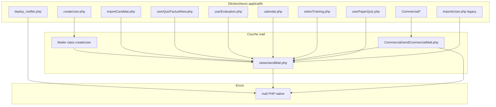

# Système de mailing — MEDACAP

> **Date d'analyse :** 3 juillet 2026  
> **Fichier central :** `views/sendMail.php`  
> **Module commercial :** `Commercial/sendCommercialMail.php`  
> **Déploiements :** `deploy_notifier.php`

---

## Architecture technique

### Comment les mails partent

| Composant | Détail |
|-----------|--------|
| **Transport** | Fonction PHP native `mail()` — **pas de SMTP PHPMailer en production** |
| **Format** | HTML UTF-8 via template `generateEmailTemplate()` |
| **Expéditeur** | `CFAO Mobility Academy <helpdeskcm@cfao.com>` |
| **Reply-To** | `helpdeskcm@cfao.com` (ou expéditeur par défaut) |
| **Librairie PHPMailer** | Présente dans `phpmailer/` mais **non utilisée** par le flux principal |

### Configuration globale (`views/sendMail.php`)

```php
const FROM_NAME         = 'CFAO Mobility Academy';
const FROM_EMAIL        = 'helpdeskcm@cfao.com';
const SUPER_ADMIN_EMAIL = 'jakaa-ext@cfao.com';

const CC_STATIC = [
    'aybokally@cfao.com',
    'lgonin@cfao.com',
    SUPER_ADMIN_EMAIL,  // toujours en copie
];
```

### CC statique

Presque tous les mails MEDACAP (via `sendTemplatedMedacapEmail` et `buildHeaders`) incluent **automatiquement** :

- `aybokally@cfao.com`
- `lgonin@cfao.com`
- `jakaa-ext@cfao.com`

**Exception :** le module commercial utilise `sendCommercialEmail()` **sans** CC statique.

### Liens plateforme (`medacapLinkForCountry`)

| Pays | URL |
|------|-----|
| Cameroun | `http://10.68.0.7/medacap/` |
| Autres | `http://129.0.64.34/medacap` |

---

## Chaîne d'appel



---

## Catalogue des emails — Quand / Pourquoi / À qui / Comment

### Légende statut

| Statut | Signification |
|--------|---------------|
| ✅ Actif | Appelé depuis le code en production |
| ⚠️ Legacy | Ancien flux, encore présent |
| 🔧 Prévu | Fonction définie mais **non branchée** (aucun appelant) |

---

## 1. Onboarding & création de comptes

### 1.1 Accès utilisateur (Manager, Admin, RH, Directeur)

| | |
|---|---|
| **Quand** | Création manuelle via `views/explore/createUser.php` |
| **Pourquoi** | Activer le compte et transmettre identifiant + mot de passe |
| **À qui** | Email saisi à la création (Manager, Admin, RH, Directeur) |
| **Comment** | `Mailer::notifySelfAccess()` → `sendTemplatedMedacapEmail()` |
| **Objet** | Ex. `MEDACAP — Votre accès Manager est activé` |
| **CC** | CC_STATIC |
| **Statut** | ✅ Actif |

### 1.2 Nouveau technicien → manager

| | |
|---|---|
| **Quand** | Création technicien via `createUser.php` |
| **Pourquoi** | Informer le manager + lui donner les identifiants du collaborateur |
| **À qui** | Email du manager rattaché |
| **Comment** | `Mailer::notifyManagerForTechnician()` |
| **Objet** | `MEDACAP — Nouveau collaborateur rattaché à votre compte` |
| **CC** | CC_STATIC |
| **Note** | Si le technicien a un email, le mail manager précise qu'un mail a aussi été envoyé au collaborateur |
| **Statut** | ✅ Actif |

### 1.3 Candidat recrutement (création unitaire)

| | |
|---|---|
| **Quand** | Création candidat via `createUser.php` (stratégie Candidat) |
| **Pourquoi** | Inviter le candidat à passer les QCM factuels |
| **À qui** | Email du candidat |
| **Comment** | `Mailer::notifyCandidateRecruitment()` |
| **Objet** | `MEDACAP — Vos identifiants pour les tests de recrutement` |
| **CC** | CC_STATIC |
| **Statut** | ✅ Actif |

### 1.4 Onboarding générique par rôle

| | |
|---|---|
| **Quand** | — |
| **Pourquoi** | Template onboarding Admin/Directeur/Technicien/Candidat/Super Admin |
| **À qui** | Destinataire passé en paramètre |
| **Comment** | `sendBrandedAccountEmail()` + `buildVibrantOnboardingContent()` |
| **Statut** | 🔧 Prévu — **fonction définie, aucun appelant** (remplacée par `Mailer::notifySelfAccess`) |

---

## 2. Import candidats (recrutement masse)

### 2.1 Récapitulatif RH après import Excel

| | |
|---|---|
| **Quand** | Finalisation import dans `views/measure/importCandidat.php` (bouton « Conclure ») ou import stage `views/explore/importCandidat.php` |
| **Pourquoi** | Donner au RH la liste des identifiants/mots de passe à transmettre aux candidats |
| **À qui** | Email du responsable RH sélectionné |
| **Comment** | `sendCandidateImportSummaryMail()` |
| **Objet** | `Compte(s) des Candidats de la Campagne de {campagne}` |
| **Contenu** | Tableau HTML nom/prénom/identifiant/mot de passe + comptes démo internes |
| **CC** | CC_STATIC (sauf mode test) |
| **Statut** | ✅ Actif |

### 2.2 Mail test import (aperçu)

| | |
|---|---|
| **Quand** | Bouton test dans `importCandidat.php` |
| **Pourquoi** | Prévisualiser le mail sans envoyer aux RH |
| **À qui** | `SUPER_ADMIN_EMAIL` |
| **Comment** | `sendCandidateImportSummaryMail(..., $noCc = true)` → préfixe `[TEST]` |
| **CC** | Aucun |
| **Statut** | ✅ Actif |

### 2.3 Renvoi manuel

| | |
|---|---|
| **Quand** | `views/measure/resend_import_mail.php` |
| **Pourquoi** | Renvoyer le récap import à un RH |
| **À qui** | RH ciblé |
| **Comment** | `sendCandidateImportSummaryMail()` |
| **Statut** | ✅ Actif |

### 2.4 Nouveau candidat / tests terminés (notification admin)

| | |
|---|---|
| **Quand** | — |
| **Pourquoi** | Alerter admins filiale à la création ou fin de tests candidat |
| **À qui** | Admins filiale (+ managers en CC) |
| **Comment** | `sendCandidateCreationMail()` / `sendCandidateFinishedMail()` |
| **Statut** | 🔧 Prévu — **non branché** |

---

## 3. Évaluations QCM (techniciens)

### 3.1 QCM Connaissance (Factuel) finalisé

| | |
|---|---|
| **Quand** | Soumission QCM factuel technicien (`views/measure/userQuizFactuelNew.php`) |
| **Pourquoi** | Informer admins filiale qu'un technicien a terminé son QCM |
| **À qui** | **TO :** admins filiale (`profile=Admin`, même subsidiary) |
| **CC** | Manager du technicien + RH + Directeur Pièce et Service de la filiale |
| **Comment** | `sendMailQcmFinalized()` |
| **Objet** | `QCM Connaissance finalisé par le Technicien {nom} pour le Niveau {level}` |
| **Statut** | ✅ Actif |

### 3.2 QCM Tâche Professionnelle (manager évalue)

| | |
|---|---|
| **Quand** | Manager finalise l'évaluation tâche (`views/measure/userEvaluation.php`) |
| **Pourquoi** | Notifier admins que le manager a validé le QCM tâche d'un collaborateur |
| **À qui** | Admins filiale |
| **CC** | Manager + RH + DPS |
| **Comment** | `sendMailQcmFinalized()` |
| **Objet** | FR ou EN (Rwanda) |
| **Statut** | ✅ Actif |

### 3.3 QCM Déclaratif finalisé

| | |
|---|---|
| **Quand** | — |
| **Comment** | `sendMailQcmFinalized()` commenté dans `userQuizDeclaratif.php` |
| **Statut** | ⚠️ Désactivé (code commenté) |

---

## 4. Calendrier tests

### 4.1 Test programmé

| | |
|---|---|
| **Quand** | Création événement calendrier (`views/measure/calendar.php`, `calendar_new.php`, `views/calendar.php`) |
| **Pourquoi** | Confirmer la planification d'une évaluation |
| **À qui** | Admins / Super Admin de la filiale |
| **CC** | Emails managers des techniciens concernés |
| **Comment** | `sendTestScheduledMail()` |
| **Objet** | `MEDACAP — Évaluation programmée : {nom}` |
| **Langue** | FR ou EN selon `language` admin / filiale Rwanda |
| **Statut** | ✅ Actif |

### 4.2 Rappels J-1 / Jour J / Retard

| | |
|---|---|
| **Fonctions** | `sendTestDayBeforeMail()`, `sendTestDayOfMail()`, `sendTestDelayedMail()` |
| **Pourquoi** | Rappels automatiques avant/pendant/après date test |
| **À qui** | Admins + managers (même logique CC) |
| **Statut** | 🔧 Prévu — **définies dans sendMail.php, aucun cron ni appelant** |

> Les champs `reminderStatus` existent dans `calendars` (`dayBefore`, `dayOf`, `dayAfter`) mais ne déclenchent pas encore d'envoi.

---

## 5. Formations (Define)

### 5.1 Pré-inscription formation validée

| | |
|---|---|
| **Quand** | Manager sélectionne dates/techniciens (`views/define/selectTraining.php`, `selectTraining_fixed.php`) |
| **Pourquoi** | Notifier le Super Admin qu'une pré-inscription a été faite |
| **À qui** | `jakaa-ext@cfao.com` (SUPER_ADMIN_EMAIL) |
| **CC** | CC_STATIC |
| **Comment** | `sendMailSelectDone()` |
| **Objet** | `Confirmation de la pré-inscription de {manager}` |
| **Statut** | ✅ Actif |

### 5.2 Formation enregistrée (formateur)

| | |
|---|---|
| **Quand** | Inscription technicien à formation (`views/define/registerTechnician.php`) |
| **Pourquoi** | Confirmer l'enregistrement |
| **À qui** | Email du technicien |
| **CC** | Formateur + `ceyinga-ext@cfao.com` |
| **Comment** | `sendMailRegisterTraining()` |
| **Statut** | ✅ Actif |

---

## 6. Import utilisateurs legacy

### 6.1 Confirmation inscription technicien → manager

| | |
|---|---|
| **Quand** | Import masse via `views/explore/importeUser.php` |
| **Pourquoi** | Confirmer au manager l'inscription de son collaborateur |
| **À qui** | Email du manager |
| **Comment** | `sendMailRegisterUser()` |
| **Langue** | FR (défaut) ou EN (Rwanda) |
| **CC** | CC_STATIC |
| **Statut** | ⚠️ Legacy (flux import ancien, fichier volumineux) |

---

## 7. Signalements & ops

### 7.1 Image question manquante (quiz candidat)

| | |
|---|---|
| **Quand** | Candidat signale une image absente (`views/measure/userPaperQuiz.php`) |
| **Pourquoi** | Alerter l'équipe support/contenu |
| **À qui** | `jakaa-ext@cfao.com` |
| **CC** | `imbowou-ext@cfao.com` (sans CC_STATIC) |
| **Comment** | `sendMailQuizQuestionReport()` |
| **Objet** | `[MEDACAP] Signalement image — {ref question}` |
| **Statut** | ✅ Actif |

### 7.2 Déploiement production

| | |
|---|---|
| **Quand** | Appel HTTP à `deploy_notifier.php` après déploiement |
| **Pourquoi** | Confirmer mise en prod + log MongoDB `deployments` |
| **À qui** | `jakaa-ext@cfao.com, imbowou-ext@cfao.com` |
| **Comment** | `mail()` direct (template HTML custom, hors sendMail.php) |
| **Objet** | `[ASSET] Deploiement MEDACAP effectue` |
| **CC** | Aucun |
| **Statut** | ✅ Actif |

### 7.3 Correction identifiants (script admin)

| | |
|---|---|
| **Quand** | Super Admin via `fix_username.php` |
| **Pourquoi** | Renvoyer identifiants corrigés |
| **À qui** | Technicien (si email) ou son manager (sinon) |
| **Comment** | `generateEmailTemplate()` + `sendTemplatedMedacapEmail()` |
| **Statut** | ✅ Actif (outil temporaire) |

---

## 8. Module Commercial

Flux séparé via `Commercial/sendCommercialMail.php` — **sans CC_STATIC**.

### 8.1 Accès questionnaire commercial

| | |
|---|---|
| **Quand** | Inscription commercial (`Commercial/register.php`) |
| **Pourquoi** | Tracer qu'un commercial a commencé un questionnaire |
| **À qui** | SUPER_ADMIN |
| **CC** | Aucun |
| **Statut** | ✅ Actif |

### 8.2 Questionnaire soumis

| | |
|---|---|
| **Quand** | Soumission questionnaire (`Commercial/open-questionnaire.php`) |
| **Pourquoi** | Notifier qu'un questionnaire est complété + lien téléchargement Excel |
| **À qui** | SUPER_ADMIN |
| **CC** | `commercial_admins` actifs |
| **Statut** | ✅ Actif |

### 8.3 Renvoi / correction manuelle

| | |
|---|---|
| **Quand** | Super Admin via `Commercial/mail-manager.php` |
| **Pourquoi** | Renvoyer notification avec liens correction + download |
| **À qui** | SUPER_ADMIN |
| **CC** | commercial_admins |
| **Statut** | ✅ Actif |

### 8.4 Correction finalisée

| | |
|---|---|
| **Quand** | Correcteur termine (`Commercial/correction.php`) |
| **Pourquoi** | Diffuser le score aux parties prenantes |
| **À qui** | SUPER_ADMIN + correcteurs + correcteur courant |
| **CC** | Aucun |
| **Objet** | `[CFAO Academy] Correction terminée — {nom} ({marque})` |
| **Statut** | ✅ Actif |

### 8.5 Export Excel en pièce jointe

| | |
|---|---|
| **Fonction** | `sendCommercialEmailWithExcel()` |
| **Comment** | Multipart MIME base64 |
| **Statut** | 🔧 Définie, usage à confirmer selon flux download |

---

## Résolution des destinataires (helpers MongoDB)

| Helper | Rôle |
|--------|------|
| `getAdminsDocs($collab, $mongo)` | Admins filiale (+ filtre department/agency si plusieurs) |
| `getRhAndDpsEmails($subsidiary, $mongo)` | Emails RH + Directeur Pièce et Service |
| `buildAdminSalutation($adminDocs)` | Salutation FR/EN selon genre et filiale Rwanda |
| `getTechnicianDocs($ids, $mongo)` | Docs techniciens pour calendrier |

---

## Matrice récapitulative

| Événement | Destinataire principal | CC typique | Fonction |
|-----------|------------------------|------------|----------|
| Création Manager/Admin/RH/Directeur | Utilisateur créé | CC_STATIC | `Mailer::notifySelfAccess` |
| Création technicien | Manager | CC_STATIC | `Mailer::notifyManagerForTechnician` |
| Création candidat (unitaire) | Candidat | CC_STATIC | `Mailer::notifyCandidateRecruitment` |
| Import candidats masse | RH | CC_STATIC | `sendCandidateImportSummaryMail` |
| QCM factuel terminé | Admins filiale | Manager + RH + DPS | `sendMailQcmFinalized` |
| QCM tâche manager | Admins filiale | Manager + RH + DPS | `sendMailQcmFinalized` |
| Test calendrier créé | Admins filiale | Managers techniciens | `sendTestScheduledMail` |
| Pré-inscription formation | Super Admin | CC_STATIC | `sendMailSelectDone` |
| Signalement image quiz | Support dev | imbowou-ext | `sendMailQuizQuestionReport` |
| Déploiement prod | Dev team | — | `deploy_notifier.php` |
| Questionnaire commercial | Super Admin | commercial_admins | `sendCommercialEmail` |

---

## Points d'attention

1. **Dépendance `mail()` PHP** — fonctionne si le serveur WAMP/IIS a un relais SMTP configuré (`php.ini` → `SMTP` / sendmail). Pas de retry ni file d'attente.

2. **Mots de passe en clair dans les emails** — `visiblePassword` est inclus dans les mails onboarding/import. Risque sécurité si boîtes compromises.

3. **CC systématique** — 3 adresses CFAO reçoivent quasi tous les mails MEDACAP (volume + confidentialité).

4. **Fonctions orphelines** — rappels calendrier, notifications candidat admin, `sendBrandedAccountEmail` : code prêt mais non connecté.

5. **QCM déclaratif** — notification admin désactivée (commentée).

6. **Double stack** — `createUser.php` (Mailer moderne) vs `importeUser.php` (legacy `sendMailRegisterUser`) coexistent.

7. **PHPMailer installé mais inutilisé** — migration SMTP authentifié nécessiterait refactor vers PHPMailer ou API Graph/SendGrid.

---

## Fichiers clés

| Fichier | Rôle |
|---------|------|
| `views/sendMail.php` | Hub central : templates, helpers, 15+ fonctions d'envoi |
| `views/explore/createUser.php` | Classe `Mailer` — onboarding moderne |
| `views/measure/importCandidat.php` | Import candidats + mail RH |
| `Commercial/sendCommercialMail.php` | Variante sans CC statique |
| `deploy_notifier.php` | Notification déploiement standalone |
| `views/test_mail.php` | Page de test manuel |
| `scripts/preview_import_mail.php` | Preview HTML mail import |
| `public/previews/import-candidats-mail.html` | Aperçu statique |
